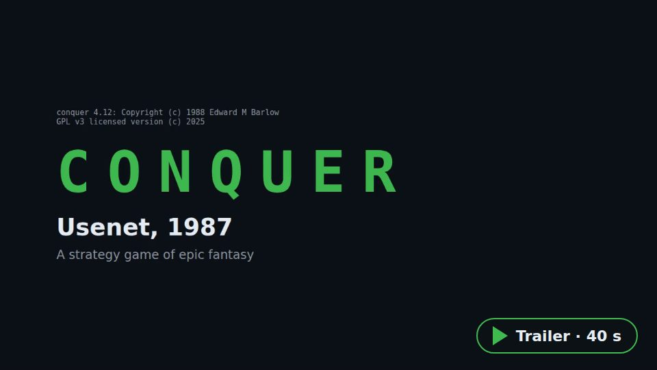
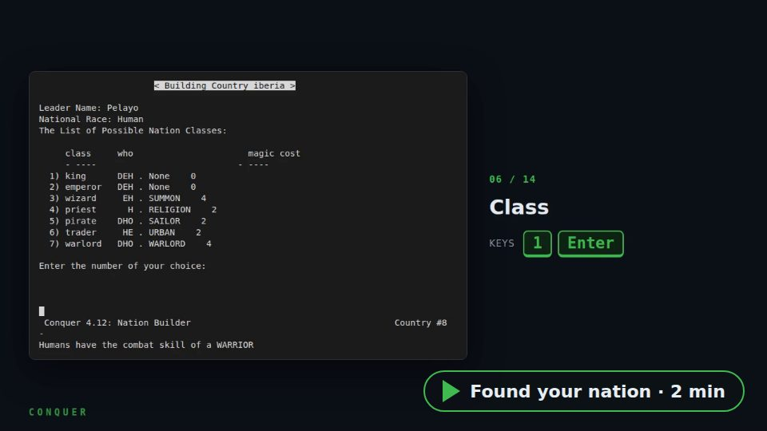
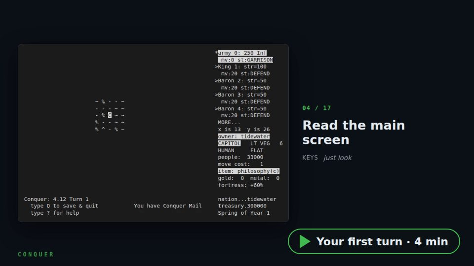

# Conquer Web

<!--
SPDX-FileCopyrightText: 2025 Juan Manuel Méndez Rey
SPDX-License-Identifier: GPL-3.0-or-later
-->

Conquer is a multiplayer strategy game from Usenet, 1987: a fantasy world,
nations, armies, one turn at a time. Conquer Web runs it in a Docker
container, shows its terminal in the browser (ttyd) behind Apache with
HTTPS, and adds what a public server needs: a home page with the live game
state, a practice game that runs in the visitor's browser, player accounts
with requests approved by the administrator, turn updates on a schedule,
seasons with a hall of fame, backups and notifications.

## Play now

| Server | What is there |
|--------|---------------|
| **[conquer.vejeta.com](https://conquer.vejeta.com)** | The live game, run by the author of this project: a shared world with scheduled turns. [Try it](https://conquer.vejeta.com/try/) with no account (a practice world in your browser); to join, ask for your seat on the home page and the administrator approves it. In English, Spanish, German, Portuguese, Polish, Russian and Chinese. |

Running your own server? Open a pull request to add it here.

<table>
<tr>
<td width="33%"><a href="https://conquer.vejeta.com/tutorial/trailer.en.mp4"></a></td>
<td width="33%"><a href="https://conquer.vejeta.com/tutorial/found-nation.en.mp4"></a></td>
<td width="33%"><a href="https://conquer.vejeta.com/tutorial.html"></a></td>
</tr>
<tr>
<td align="center"><b>Trailer</b><br>40 seconds: what Conquer is</td>
<td align="center"><b>Found your nation</b><br>the game's own builder, step by step</td>
<td align="center"><b>Your first turn</b><br>the narrated tutorial</td>
</tr>
</table>

The videos are narrated in all seven languages, with captions: the site
plays each visitor's own (`web/tutorial/<video>.<language>.mp4`, made by
`tools/tutorial/video.py`).

## How a player joins

1. **Ask for a seat** on the home page (**I want to play**, `/signup.html`):
   an account name, a password and, optionally, an email to be told when
   approved. With an invite code from the administrator the seat is
   approved at once.
2. **Wait for the administrator**, who approves the request at `/admin/`.
3. **Press Play now** and sign in with that account: the terminal menu has
   the game's nation builder found your nation (at any turn).
4. **Play**: option 1 of the menu, then your nation password. Your orders
   are resolved at the next turn update (the home page shows the schedule
   in your own time zone).
5. **Learn** at any time: the practice world at `/try/` (no account), the
   tutorial, the **Coach** button above the game and the player's guide
   (`/guide.html`).

## Quick start (local)

For development, on your own machine (Docker and docker-compose; Apache runs
in a container, with a self-signed certificate):

```bash
./setup-environment.sh     # choose 1, Local development
./start-local.sh           # https://conquer.local (accept the certificate warning)
```

The administrator's web account is made from `TTYD_USERNAME`/`TTYD_PASSWORD`
in `config/local.env` on the first start. Then `./logs.sh`, `./health-check.sh`,
`./rebuild.sh --quick` (after changing `config/local.env`) and `./stop.sh`
manage it, and `./manage-players.sh`, `./run-turn.sh` and `./add-nation.sh`
work as on a server.

## Administrator's guide

Running a public server (Debian VPS with Apache and Docker):

- **[DEPLOYMENT.md](DEPLOYMENT.md)** is the runbook: first install, updates,
  every setting, the Apache virtual host, email notifications, players and
  requests, seasons, backups, the god password and troubleshooting.
- **[QUICK-REFERENCE.md](QUICK-REFERENCE.md)** is one screen of the commands
  an administrator types every day.
- **[SECURITY.md](SECURITY.md)** covers hardening (fail2ban, rate limits,
  headers).

## Documentation

| Where | What |
|-------|------|
| [DEPLOYMENT.md](DEPLOYMENT.md), [QUICK-REFERENCE.md](QUICK-REFERENCE.md), [SECURITY.md](SECURITY.md) | Running a server |
| `/guide.html` on the site (`web/guide.html`) | The player's guide: history, workflow, advice, tournament formats |
| [tests/README.md](tests/README.md) | The tests and how CI runs them |
| [web/i18n/README.md](web/i18n/README.md), [conquer/i18n/README.md](conquer/i18n/README.md) | Adding a language (pages, terminal menu) |
| [tools/tutorial/README.md](tools/tutorial/README.md), [tools/hero/README.md](tools/hero/README.md) | The tutorial and videos; the home page map |
| [wasm/README.md](wasm/README.md) | The practice game in WebAssembly |
| [conquer/patches/README.md](conquer/patches/README.md) | Fixes applied to the game engine at build time |

## Project layout

```
conquer/       game image: Dockerfile, engine patches, default world, menu and turn scripts, sign-up service (gate), translations
web/           the site: home page, guide, tutorial, sign-up, /admin/, game page, /try/ (WebAssembly)
vps/           Apache virtual host template and systemd unit for a VPS
apache/        Apache container of the local setup
config/        environment templates (production.env, local.env, backup.env)
tools/ wasm/   tutorial and video builders, check-i18n.py, WebAssembly build
tests/         pytest suites (see tests/README.md)
*.sh           administration scripts (see QUICK-REFERENCE.md)
data/          live world, accounts, backups and practice worlds (created at run time, not in git)
```

## Contributing

Fork, make a branch, run the checks, open a pull request:

```bash
shellcheck -S warning -x -P conquer/scripts ./*.sh conquer/scripts/*.sh conquer/i18n/*.sh
python3 tools/check-i18n.py
python3 -m pytest -m "not browser and not game"
```

## License

GPL v3 or later; see [LICENSE.md](LICENSE.md). The game is
[Conquer](https://github.com/vejeta/conquer), with thanks to ttyd, Docker and
Let's Encrypt.
